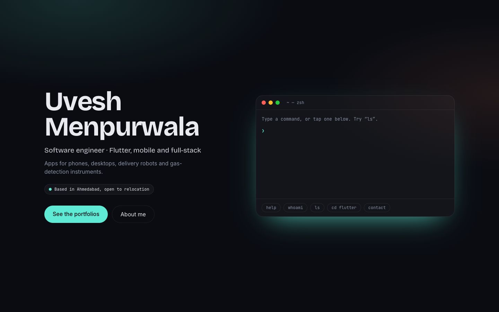
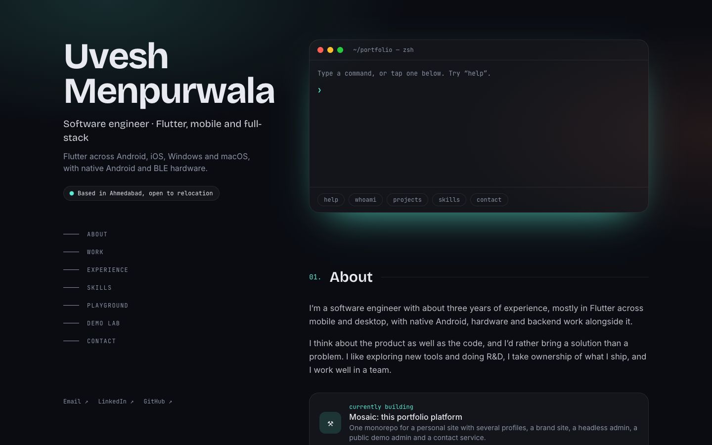
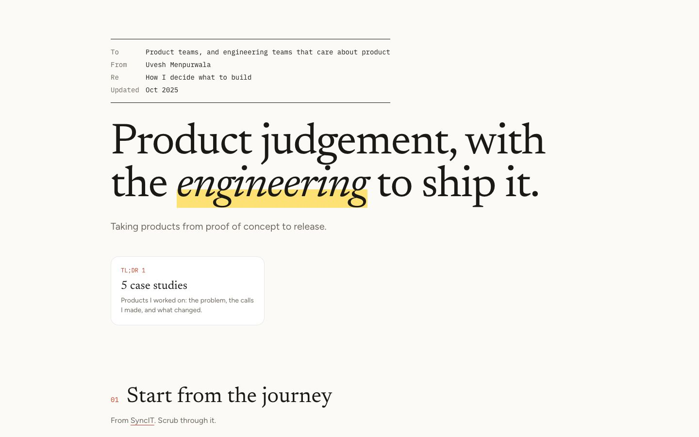
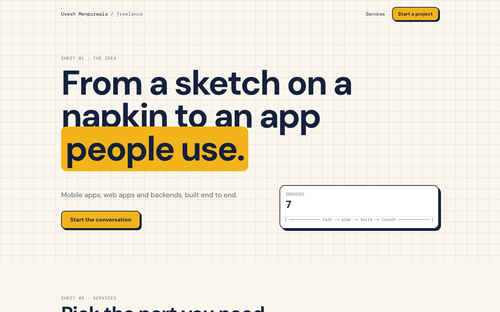
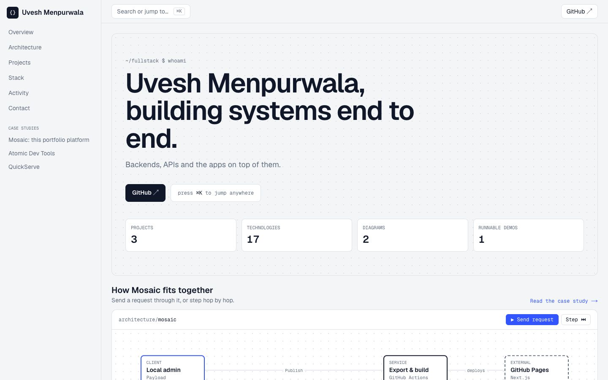
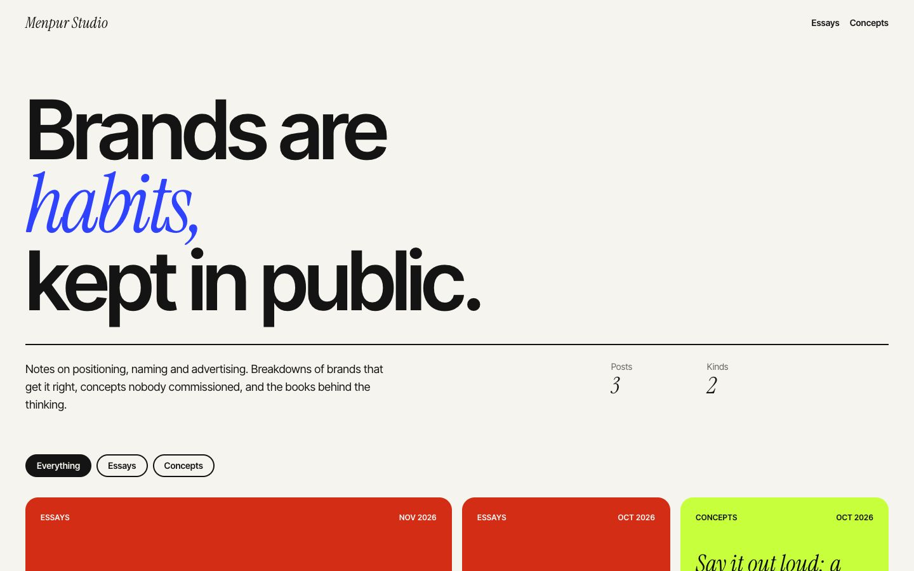
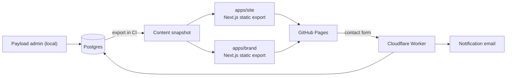

# Mosaic

My portfolio platform, live at **[uveshm003.github.io](https://uveshm003.github.io)**. A home page leads to four portfolios (Flutter, Product, Freelance and Full-stack), each with its own design, plus a separate brand site. One monorepo builds all of them.

| Home                                                                                             | Flutter                                                                                         |
| ------------------------------------------------------------------------------------------------ | ----------------------------------------------------------------------------------------------- |
| [](https://uveshm003.github.io/)                           | [](https://uveshm003.github.io/flutter)       |
| **Product**                                                                                      | **Freelance**                                                                                   |
| [](https://uveshm003.github.io/product)        | [](https://uveshm003.github.io/freelance) |
| **Full-stack**                                                                                   | **Brand**                                                                                       |
| [](https://uveshm003.github.io/fullstack) | [](https://uveshm003.github.io/brand/)                 |

## What's interesting here

- **Five designs, one codebase.** Each portfolio is a Next.js route group with its own fonts, theme tokens, motion and component variants, on top of shared unstyled primitives (`packages/ui`, `packages/tokens`).
- **Edited in a CMS, served as static files.** Content is written in a local Payload admin backed by Postgres. CI exports the published content to a JSON snapshot and builds both sites as static exports for GitHub Pages, so nothing runs on a server in production. A production build refuses a snapshot that contains seed data or drafts.
- **Schema changes are guarded.** Development syncs the schema from code; production changes only through migrations. CI fails when the schema changes without a migration, or when the generated Payload files drift.
- **A contact form with no app server.** A Cloudflare Worker checks the origin, validates with Zod, drops honeypot hits and verifies Turnstile, then inserts as an insert-only database role and sends one notification email with every value HTML-escaped.
- **Tested end to end, with budgets.** Every pull request builds both sites from seed data, assembles them like the deploy, then crawls and smoke-tests every portfolio with Playwright. Every page is checked against WCAG 2.2 AA with axe in light and dark, tabbed through for a visible focus ring, checked for no motion when reduced motion is asked for, and held to a 150 KB script budget, and Lighthouse runs on every page template. The deploy runs the same checks on the real content before it publishes. The Flutter web demos in the Flutter portfolio's demo lab are analyzed, tested and built in CI too.



The full design is in [docs/SPEC.md](docs/SPEC.md), with decisions in [docs/decisions](docs/decisions), progress in [docs/checkpoints.md](docs/checkpoints.md) and the platform's own [case study](docs/case-studies/mosaic.md).

## Development

The rest of this README covers working on the repository.

### Layout

| Path               | What                                                          |
| ------------------ | ------------------------------------------------------------- |
| `apps/site`        | Personal site: root page and profiles (Next.js static export) |
| `apps/brand`       | Brand site (Next.js static export)                            |
| `apps/cms`         | Payload admin (Phase 1)                                       |
| `workers/contact`  | Contact form Worker                                           |
| `demos/flutter`    | Flutter web demos (Phase 2)                                   |
| `packages/content` | Collections, schemas and the content snapshot                 |
| `packages/ui`      | Unstyled primitives shared by both sites                      |
| `packages/tokens`  | Theme tokens per profile and for the brand                    |
| `packages/seed`    | Seed data and purge                                           |
| `packages/resume`  | Resume export                                                 |
| `packages/config`  | Shared TypeScript and ESLint config                           |

### Commands

Requires Node 26 (`.nvmrc`) and pnpm 12 (`npm install -g pnpm`; it switches itself to the `packageManager` version).

```sh
pnpm install
pnpm build          # build every app
pnpm lint
pnpm typecheck
pnpm test
pnpm format         # Prettier
pnpm --filter @mosaic/site dev
pnpm --filter @mosaic/brand dev
```

#### Admin (`apps/cms`)

The admin only starts through these commands, each reading its own env file
(`apps/cms/.env.dev`, `apps/cms/.env.prod`; values in the file win over the shell):

```sh
pnpm cms:dev    # dev database, schema synced from code, http://localhost:3000/admin
pnpm cms:prod   # production database, migrations only, http://localhost:3001/admin
```

Sample data (dev database only; `seed` refuses `APP_ENV=production` and the production host from `.env.prod`):

```sh
pnpm seed         # replace sample data: "Sample:" titles, every collection and profile, marked _seed
pnpm seed:purge   # delete every _seed document and blank seeded globals
```

Content snapshot (what the sites build from; written to `packages/content/snapshot/`, never committed):

```sh
pnpm content:export                              # CI: reads the env it is given
pnpm --filter @mosaic/cms content:export:dev     # from the dev database
pnpm preview                                     # dev content with drafts, then the site dev server
```

A production export or build refuses snapshots that contain seed data or drafts.

Migrations: dev syncs its schema from code, production only changes through migrations
in `apps/cms/src/migrations`. CI fails if the schema changes without one.

```sh
pnpm --filter @mosaic/cms payload:dev migrate:create <name>   # after changing a collection or global
pnpm --filter @mosaic/cms payload:prod migrate                 # apply to production
```

Payload CLI commands go through the same files: `pnpm --filter @mosaic/cms payload:dev migrate:status`.

Integration tests and local admin work use the Postgres in `docker-compose.yml`:

```sh
docker compose up -d
pnpm --filter @mosaic/cms test
```

After changing a collection or global, regenerate the committed files (CI fails if they drift):

```sh
pnpm --filter @mosaic/cms generate:types
pnpm --filter @mosaic/cms generate:importmap
```

Both need `APP_ENV=test`, `DATABASE_URL` and `PAYLOAD_SECRET` set.

Env templates: `apps/cms/.env.{dev,prod}.example`, `apps/site/.env.example`, `apps/brand/.env.example`, `workers/contact/.dev.vars.example`. Copy them without the `.example` suffix; the copies are git-ignored.

#### Contact Worker (`workers/contact`)

Receives contact-form posts: checks the origin, validates with Zod, drops honeypot hits,
verifies Turnstile, inserts into `inquiries` as the insert-only `contact_worker` role, and
sends one Resend notification with every value HTML-escaped.

```sh
pnpm --filter @mosaic/contact-worker dev      # local, with workers/contact/.dev.vars
pnpm --filter @mosaic/contact-worker test     # unit tests
MIGRATED_DATABASE_URL=… pnpm --filter @mosaic/contact-worker test:int   # against a migrated DB
pnpm --filter @mosaic/contact-worker deploy   # needs `wrangler login`
```

Production secrets (`wrangler secret put`): `DATABASE_URL`, `TURNSTILE_SECRET_KEY`, `RESEND_API_KEY`.
The `contact_worker` role is created by hand on each Neon branch; its grants live in a
migration, which must be re-run if `inquiries` is rebuilt.

#### End-to-end checks (`e2e`)

They run against both sites built from the current snapshot, assembled like the deploy and
served the way GitHub Pages serves them (gzipped, `/a` from `a.html`):

```sh
pnpm --filter @mosaic/site build && pnpm --filter @mosaic/brand build
pnpm --filter @mosaic/e2e assemble
pnpm --filter @mosaic/e2e test:e2e     # crawl, smoke, WCAG 2.2 AA, keyboard, motion, script budget
pnpm --filter @mosaic/e2e lighthouse   # mobile, one page per template; reports in e2e/.lighthouseci
pnpm --filter @mosaic/e2e og:images    # share images and icons, after a tagline, colour or font change
```

Lighthouse budgets: Performance, Accessibility and Best Practices 95+ and SEO 100 on the
personal site; Performance 85+ and Accessibility 95+ on the brand, which has no SEO score while
it is `noindex`. The first run needs `pnpm --filter @mosaic/e2e exec playwright install chromium`,
and Lighthouse needs Chrome.
